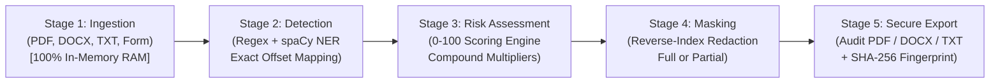

# 🛡️ PrivacyGuard AI – Autonomous PII Detection & Data Sanitization Firewall

<div align="center">


**A proactive cybersecurity & AI privacy firewall that detects Personally Identifiable Information (PII), evaluates privacy risk scores (0–100), and auto-redacts sensitive documents directly in volatile RAM.**

[Key Features](#-key-features) • [Tech Stack Used](#-technology-stack--libraries-used) • [5-Stage Architecture](#-system-architecture--workflow) • [Installation](#-installation--quick-start) • [Compliance](#-regulatory-compliance) • [Tests](#-testing--validation)

</div>

---

## 📌 Executive Summary

**PrivacyGuard AI** is an intelligent, privacy-first cybersecurity platform engineered to eliminate sensitive data leakage in files and manual data entries. Built with zero-disk persistence, documents and text streams are parsed and redacted **strictly inside volatile memory (RAM)**, leaving zero forensic trace on local storage. 

By unifying **hybrid NLP Named Entity Recognition (NER)** and **deterministic Regular Expressions (Regex)**, PrivacyGuard spots identity markers, financial credentials, national IDs (Aadhaar, PAN), and secret API keys with micro-second latency. It then quantifies the threat using a **0–100 compound privacy risk score** and sanitizes the output using a collision-proof **reverse-index masking engine** before exporting audit-ready PDF, Word (DOCX), or Text files.

---

## ⚡ Key Features

- **🔒 100% In-Memory (Zero Disk Footprint):** Files are ingested into `io.BytesIO` memory buffers. No sensitive text or documents are ever written to disk, guaranteeing forensic data privacy.
- **🧠 Hybrid AI Detection Engine:** Combines spaCy's linguistic Named Entity Recognition (`en_core_web_sm`) for contextual entities (Names, Organizations, Locations) with high-precision Regex for structured identifiers.
- **🪪 Comprehensive Entity Coverage:**
  - **Personal Details:** Full Names, Emails, Phone Numbers (Indian & Global), Residential Addresses, Dates of Birth.
  - **Government & National IDs:** 12-digit Indian Aadhaar patterns, 10-character alphanumeric PAN numbers.
  - **Financial Credentials:** Credit/Debit Cards (Visa, Mastercard, Amex, Discover - PCI-DSS).
  - **Infrastructure Secrets:** GitHub tokens (`ghp_`), Google AI API keys (`AIza`), Stripe keys (`sk_live_`), Bearer tokens, and password strings.
- **📊 Dynamic 0–100 Privacy Risk Assessment:**
  - Evaluates cumulative severity based on categorized sensitivity weights.
  - Applies **Compound Correlation Multipliers** (e.g., Name + ID = +15 pts penalty; Personal ID + Financial Card = +18 pts penalty).
  - Categorizes threat into **Low (0–30)**, **Medium (31–60)**, and **Critical/High (61–100)**.
- **🎭 Dual Sanitization Modes:**
  - **Full Redaction:** Complete blackout replacements (e.g., `[REDACTED: EMAIL]`).
  - **Context-Preserving Partial Masking:** Retains readability while neutralizing risks (e.g., `j****@domain.com`, `******3210`, `**** **** 9012`).
- **📐 Collision-Proof Reverse-Index Masking:** Redacts entities from highest string offsets to lowest, ensuring index boundaries never drift during multi-entity substitutions.
- **📄 Multi-Format Ingestion & Export:**
  - **Input:** PDF, Microsoft Word (`.docx`), Plain Text (`.txt`), and interactive form inputs.
  - **Export:** Sanitized `.txt`, sanitized `.docx`, and cryptographic audit-ready `.pdf` via ReportLab.
- **📈 Real-Time Telemetry & Deduplication:** Tracks live documents scanned, items redacted, and safe outputs with SHA-256 fingerprint deduplication.
- **🎨 Modern Cyberpunk UI:** Custom responsive dark interface styled with `#0A192F` (Deep Navy) and `#00E5FF` (Electric Cyan).

---

## 🛠️ Technology Stack & Libraries Used

PrivacyGuard AI was built with a curated set of modern Python libraries and security frameworks:

### 1. Web Application & UI Framework
| Technology | Version | Purpose |
| :--- | :--- | :--- |
| **[Streamlit](https://streamlit.io/)** | `>=1.30.0` | Powers the reactive multi-page web application, dynamic session states, stateful routing, and interactive visual components. |
| **Custom CSS3 & HTML5** | Built-in | Custom Cyber-Navy & Electric-Cyan design system, animated KPI stat cards, and SVG Shield-and-Lock branding. |

### 2. Natural Language Processing & Pattern Recognition
| Technology | Version | Purpose |
| :--- | :--- | :--- |
| **[spaCy](https://spacy.io/)** | `>=3.7.0` | Natural Language Processing (NLP) framework for linguistic Named Entity Recognition (`en_core_web_sm`) identifying contextual names, places, and organizations. |
| **Python `re` (Regex)** | Standard Lib | Deterministic regular expression engine tailored for RFC-compliant emails, international phone numbers, Aadhaar, PAN, payment cards, and secret keys. |

### 3. Document Parsing & Generation
| Technology | Version | Purpose |
| :--- | :--- | :--- |
| **[PyPDF](https://pypi.org/project/pypdf/)** | `>=4.0.0` | Memory-efficient extraction and page-by-page parsing of PDF documents. |
| **[python-docx](https://python-docx.readthedocs.io/)** | `>=1.0.0` | Ingestion, paragraph-level text extraction, and sanitized DOCX document synthesis. |
| **[ReportLab](https://www.reportlab.com/)** | `>=4.0.0` | Programmatic vector PDF compilation, audit certificate stamping, and compliance document export. |

### 4. Data Processing, Telemetry & Security
| Technology | Version | Purpose |
| :--- | :--- | :--- |
| **[Pandas](https://pandas.pydata.org/)** | `>=2.0.0` | Session telemetry compilation, tabular entity summaries, and metrics tracking. |
| **`hashlib` (SHA-256)** | Standard Lib | Non-reversible content fingerprinting to identify unique document streams without caching raw PII. |
| **`io.BytesIO`** | Standard Lib | Pure RAM stream buffers ensuring zero temporary files touch the physical disk. |

---

## 🔄 System Architecture & Workflow

PrivacyGuard executes an automated 5-stage privacy defense pipeline:



### Pipeline Overview:
1. **Ingestion:** Streams uploaded files or manual forms into RAM via `io.BytesIO`. Validates file integrity and character encodings.
2. **Detection:** Simultaneously scans text with spaCy NER (semantic entities) and deterministic Regex (structured tokens), indexing exact character `[start:end]` spans.
3. **Risk Assessment:** Calculates category weights, frequency factors, and compound correlation rules (e.g., identity + financial pairing) to yield a 0–100 risk score.
4. **Masking:** Runs reverse-index substitution (`reversed(sorted_entities)`) to preserve character positions, generating sanitized text according to the selected redaction mode.
5. **Vault & Download:** Produces sanitized, audit-ready PDF, Word, and text files ready for export, updating real-time session telemetry.

---

## 📂 Project Structure

```
PrivacyGuardAI/
├── .streamlit/
│   └── config.toml               # Streamlit theme configuration (Dark Navy #0A192F)
├── sample_documents/             # Included realistic sample files for instant testing
│   ├── sample_resume.txt         # Synthetic resume with names, contacts, and emails
│   ├── employee_kyc_record.txt   # Synthetic KYC record with Aadhaar, PAN, and address
│   └── medical_intake_form.txt   # Synthetic clinical record with DOB and insurance IDs
├── app.py                        # Application entry point, session management & routing
├── components.py                 # Reusable UI widgets (5-stage stepper, risk meter, KPI cards)
├── data_handler.py               # In-memory document parser (PDF, DOCX, TXT) & validator
├── detector.py                   # Sensitive PII & secrets detection engine (Regex + spaCy NER)
├── risk_assessment.py            # Rule-based 0-100 privacy risk scoring & compound multipliers
├── masking.py                    # Reverse-index text redaction & partial masking engine
├── masking_engine.py             # Masking rule helpers and string transformations
├── document_generator.py         # Multi-format document builder (ReportLab PDF, DOCX, TXT)
├── styles.py                     # Custom CSS styling, responsive layouts & vector branding
├── telemetry.py                  # Live session stats, deduplication & SHA-256 fingerprinting
├── views.py                      # View controllers for all 7 application pages
├── test_complete_application.py  # End-to-end integration test suite (11 test cases)
├── test_detector.py              # Unit tests for the detection engine
├── test_risk.py                  # Unit tests for risk scoring algorithms
├── test_masking_and_download.py  # Unit tests for redaction & document generation
├── test_modules.py               # Unit tests for file extraction & form validation
└── requirements.txt              # Production Python package dependencies
```

---

## 🚀 Installation & Quick Start

### 1. Prerequisites
- **Python 3.9, 3.10, or 3.11** installed on your system.
- Git installed.

### 2. Clone the Repository
```bash
git clone https://github.com/<your-username>/PrivacyGuardAI.git
cd PrivacyGuardAI
```

### 3. Create a Virtual Environment
```bash
# Windows (PowerShell / Command Prompt)
python -m venv venv
.\venv\Scripts\activate

# macOS / Linux
python3 -m venv venv
source venv/bin/activate
```

### 4. Install Dependencies
```bash
pip install --upgrade pip
pip install -r requirements.txt
```

### 5. (Optional) Download spaCy English Model
*Note: PrivacyGuard includes an automatic fallback to spaCy's blank English model and Regex patterns if not downloaded, but installing `en_core_web_sm` provides maximum NER accuracy:*
```bash
python -m spacy download en_core_web_sm
```

### 6. Launch the Application
```bash
streamlit run app.py
```
Open your web browser and navigate to: **`http://localhost:8501`**

---

## 🧪 Testing & Validation

PrivacyGuard comes with a test suite covering unit operations and end-to-end pipelines.

Run the complete integration test suite:
```bash
python -B test_complete_application.py
```

Run specific test modules:
```bash
python -B test_detector.py
python -B test_risk.py
python -B test_masking_and_download.py
python -B test_modules.py
```

All 11 integration test scenarios validate:
- In-memory parsing of text, Word, and PDF files.
- Accurate detection of Indian national identifiers (Aadhaar, PAN), emails, and API keys.
- Mathematical accuracy of the 0–100 privacy risk scoring formulas.
- Offset preservation in reverse-index masking.
- Memory-safe PDF and DOCX file generation.

---

## ⚖️ Regulatory Compliance

PrivacyGuard helps organizations and developers comply with global data governance mandates:

| Regulation | Scope & Coverage |
| :--- | :--- |
| **GDPR** (EU) | Articles 5, 25, and 32: Data minimization, privacy-by-design, and pseudonymous tokenization of personal identifiers. |
| **DPDP Act 2023** (India) | Section 8: Obligations of Data Fiduciaries to sanitize Aadhaar numbers and financial identifiers prior to processing. |
| **HIPAA** (USA) | Safe Harbor Method: Redaction of 18 specific health and personal identifiers (Names, dates, contact vectors, SSNs). |
| **PCI-DSS** | Section 3.4: Mandatory masking of Primary Account Numbers (PANs) and financial credentials. |

---

## 📄 License

This project is licensed under the **MIT License** - see the [LICENSE](LICENSE) file for details.

---

## 🤝 Contributing

Contributions, issues, and feature requests are welcome!
1. Fork the Project
2. Create your Feature Branch (`git checkout -b feature/AmazingFeature`)
3. Commit your Changes (`git commit -m 'Add some AmazingFeature'`)
4. Push to the Branch (`git push origin feature/AmazingFeature`)
5. Open a Pull Request
